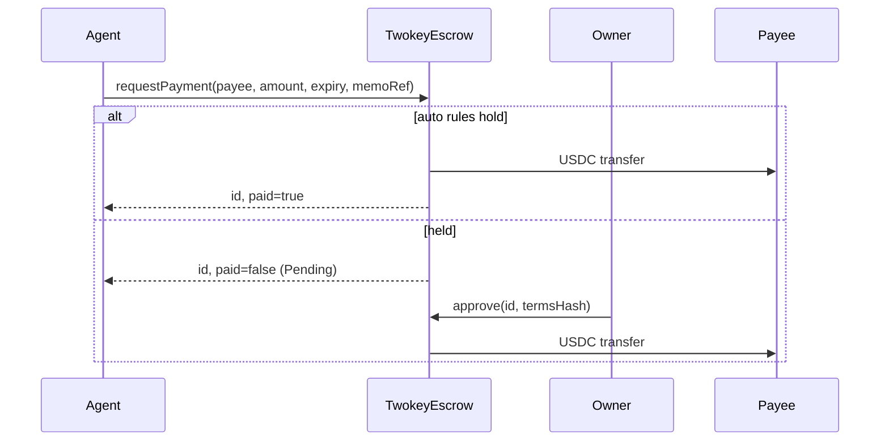

# TwokeyEscrow: Design Doc

## 1. Metadata

- Status: Draft (awaiting your confirmation)
- Target chain: Arc Testnet (chain ID 5042002). USDC ERC-20 view at `0x3600000000000000000000000000000000000000` (6 decimals)
- Language / toolchain: Solidity 0.8.28, Foundry. OpenZeppelin Contracts (version pinned by the project)
- Review tracker: [ ] Design (you) · [ ] Security review · [ ] Tests green · [ ] Fork verification before deploy

## 2. Action Items (living)

- Owner wallet address is required at deploy time (see section 12).

## 3. Goals / Non-Goals

Goals
- One owner funds an escrow with USDC and lets named AI agents ask it to pay people.
- Low-risk payments go out at once: the agent is allowed, the payee is pinned by the owner, the amount is within the payee's per-payment cap, and the agent's rolling 24h total stays within its cap.
- Everything else waits as a held request until the owner sends an approve transaction that passes the exact terms hash.
- Owner can reject, agent can cancel, requests expire, owner can pause. Fully immutable.

Non-Goals
- Multi-owner or shared deployments (one deployment per owner).
- Upgrades, proxies, fees, non-USDC payouts, oracles, cross-chain.
- Reserving funds per held request (see Tradeoffs).
- Streaming or recurring payments.

## 4. Requirements

Functional
- F1. Owner can set agents (allowed flag + rolling 24h cap) and pinned payees (per-payment cap).
- F2. An allowed agent calls `requestPayment`. If every auto-pay rule holds, USDC is sent in the same transaction. Otherwise a Pending request is stored.
- F3. Owner calls `approve(id, termsHash)`. It pays only if the request is Pending, unexpired, the hash equals the stored terms hash, and the contract is not paused.
- F4. Owner can `reject`. The requesting agent can `cancel`. Anyone can mark an expired request `Expired`.
- F5. Anyone can fund the contract by a plain USDC transfer, and the owner can `withdraw` any amount at any time (paused or not).
- F6. Owner can pause and unpause. Ownership moves in two steps and cannot be renounced.

Security (testable assertions)
- S1. USDC leaves the contract only via: auto-pay to a pinned payee within limits, `approve` to the exact payee and amount in the stored terms, or owner `withdraw`.
- S2. Over any real 24h interval, auto-paid total per agent never exceeds that agent's cap.
- S3. A single auto-payment never exceeds the payee's per-payment cap.
- S4. Stored terms of a request never change after creation; approve with a different hash always reverts.
- S5. While paused: no request, no auto-pay and no approve succeeds. Withdraw, reject, cancel, expire, and config changes still work.
- S6. A non-owner can never change config, approve, reject, withdraw, pause, or take ownership.
- S7. A request is settled at most once (status is terminal after Paid / Approved / Rejected / Cancelled / Expired).
- S8. A pending request cannot be approved after its expiry.

## 5. Terminology & Actors

- Auto limit: the pair (payee per-payment cap, agent rolling 24h cap).
- Pinned payee: an address the owner has whitelisted with a per-payment cap. Payees are pinned for the whole escrow, not per agent.
- Held request: a Pending request waiting for the owner.
- Terms hash: `keccak256(abi.encode(TERMS_TYPEHASH, escrow, chainId, id, agent, payee, amount, expiry, memoRef))`. `memoRef` is a bytes32 the agent supplies (for example a hash of the invoice or task). The contract computes and stores it; the owner's app recomputes it from the displayed terms and passes it to `approve`.

| Actor | Onchain/Off | Trust | Can do |
| --- | --- | --- | --- |
| Owner | Onchain EOA or contract wallet | Trusted | Everything privileged |
| Pending owner | Onchain | Semi-trusted until accept | Accept ownership |
| Agent | Onchain key held by an AI process | Semi-trusted (may be compromised or prompt-injected) | Request, cancel own request |
| Payee | Onchain | Untrusted | Receives USDC |
| Anyone | Onchain | Untrusted | Expire stale requests, send USDC in |

## 6. Language / Runtime

Solidity 0.8.28 (checked arithmetic, custom errors). Project's configured EVM version. Built on OZ `Ownable2Step`, `Pausable`, `ReentrancyGuard`, `SafeERC20`. `renounceOwnership` is overridden to revert.

## 7. Transaction & Execution Model

Each call is atomic. External calls happen only on USDC `safeTransfer`, always last (checks, effects, interactions) and also behind `nonReentrant`. USDC is not a callback token, so the re-entry surface is theoretical.

## 8. Chain Standards & Interfaces

- ERC-20 (USDC) via `SafeERC20`. The USDC address is a constructor argument, immutable.
- On Arc, USDC is also the native gas token. This contract uses only the ERC-20 view. It has no `receive` / `payable`, so native sends revert and nothing is double counted.
- USDC has a blocklist. A blocklisted payee makes a transfer revert (see Failure Scenarios).
- No signatures. Countersigning is an onchain transaction, so ERC-1271 and EIP-712 are not needed. The "typehash" is just a domain tag for the hash.

## 9. Architecture Overview



Flow of funds

| Step | Who moves what | Invariant |
| --- | --- | --- |
| Fund | Anyone transfers USDC to the contract | Balance rises; no internal accounting to desync |
| Auto-pay | Contract to pinned payee | amount <= payee cap; window total + amount <= agent cap; balance >= amount |
| Approve | Contract to payee | status Pending, not expired, hash matches, not paused |
| Withdraw | Contract to owner-chosen address | owner only; amount <= balance |

Resting invariant: the contract holds exactly the USDC the owner has sent in minus everything paid out or withdrawn. There is no per-request reservation, so no stranded or locked funds.

Dependencies: USDC token only.

## 10. Contract Design

Roles

| Role | Holder | Permissions | Why |
| --- | --- | --- | --- |
| Owner | One address, 2-step transfer | Config, approve, reject, withdraw, pause, rescue non-USDC tokens | Single accountable controller |
| Agent | Any number, owner-listed | `requestPayment`, `cancel` own | Least privilege: can ask, never move money beyond limits |

There is no separate pauser or admin (your choice: nothing beyond the owner).

Storage

- `IERC20 immutable usdc`
- `uint64 maxHoldDuration` (owner-set, bounded 1 hour to 90 days)
- `uint256 nextId`
- `mapping(address => Agent) agents` where `Agent { bool allowed; uint128 dailyCap; uint32 pending; }`
- `mapping(address => Payee) payees` where `Payee { bool pinned; uint128 perPaymentCap; }`
- `mapping(uint256 => Request) requests` where `Request { address agent; address payee; uint128 amount; uint64 createdAt; uint64 expiry; Status status; bytes32 memoRef; bytes32 termsHash; }`
- `mapping(address => mapping(uint64 => uint128)) autoSpentByHour` (agent, hour index = timestamp / 3600)
- `enum Status { None, Pending, Paid, Approved, Rejected, Cancelled, Expired }` (`Paid` = auto-paid)
- Constants: `WINDOW_BUCKETS = 25`, `MAX_PENDING_PER_AGENT = 32`

Rolling 24h window: the window total is the sum of the current hour bucket and the 24 before it (25 buckets). This is conservative: any spend made less than 24h ago is always counted, and a spend can be counted for up to 25h. So the true 24h total can never exceed the cap; the cost is up to one hour of extra lockout. Loop is fixed at 25 reads.

Modifiers: `onlyOwner`, `onlyAllowedAgent`, `whenNotPaused`, `nonReentrant`.

Write functions

| Function | Caller | State | Events | Reverts |
| --- | --- | --- | --- | --- |
| `requestPayment(payee, amount, expiry, memoRef) returns (id, paid)` | Allowed agent, not paused | New request; if auto: Paid + hour bucket + transfer; else Pending + `pending++` | `PaymentRequested`, then `PaymentReleased` if auto | payee zero or this; amount 0 or > uint128; expiry <= now or > now + maxHold; held and agent at 32 pending |
| `approve(id, termsHash)` | Owner, not paused | Pending to Approved, `pending--`, transfer | `PaymentReleased` | not Pending; expired; hash mismatch; insufficient USDC |
| `reject(id)` | Owner | Pending to Rejected, `pending--` | `PaymentRejected` | not Pending |
| `cancel(id)` | Request's agent | Pending to Cancelled, `pending--` | `PaymentCancelled` | not agent; not Pending |
| `expire(id)` | Anyone | Pending past expiry to Expired, `pending--` | `PaymentExpired` | not Pending; not yet expired |
| `setAgent(agent, allowed, dailyCap)` | Owner | Agent config (keeps `pending`) | `AgentSet` | zero address |
| `setPayee(payee, perPaymentCap)` | Owner | Pins payee | `PayeeSet` | zero address or this |
| `removePayee(payee)` | Owner | Unpins | `PayeeRemoved` | none |
| `setMaxHoldDuration(d)` | Owner | Updates bound | `MaxHoldDurationSet` | outside 1 hour to 90 days |
| `withdraw(to, amount)` | Owner | Transfer | `Withdrawn` | zero `to`; amount 0 |
| `rescueToken(token, to, amount)` | Owner | Recover non-USDC tokens | `TokenRescued` | token is USDC; zero `to` |
| `pause()` / `unpause()` | Owner | Pause flag | `Paused` / `Unpaused` | OZ standard |
| `transferOwnership` / `acceptOwnership` | Owner / pending owner | 2-step | OZ events | `renounceOwnership` always reverts |

Read functions: `requests(id)`, `getAgent`, `getPayee`, `maxHoldDuration`, `nextId`, `autoSpentInWindow(agent)`, `autoHeadroom(agent)` (cap minus window total), `previewAutoPay(agent, payee, amount) returns (bool, reason)` for UIs and agents, `hashTerms(id, agent, payee, amount, expiry, memoRef)`, `balance()`.

Auto-pay decision (pseudocode)

```
auto = payee.pinned
    && amount <= payee.perPaymentCap
    && windowSpent(agent) + amount <= agent.dailyCap
    && usdc.balanceOf(this) >= amount
if auto: bucket[agent][now/3600] += amount; status = Paid; usdc.safeTransfer(payee, amount)
else:    require(agent.pending < 32); status = Pending; agent.pending++
```

Events: `PaymentRequested(id indexed, agent indexed, payee indexed, amount, expiry, memoRef, termsHash)`, `PaymentReleased(id indexed, payee indexed, amount, bool auto)`, `PaymentRejected(id indexed)`, `PaymentCancelled(id indexed)`, `PaymentExpired(id indexed)`, `AgentSet`, `PayeeSet`, `PayeeRemoved`, `MaxHoldDurationSet`, `Withdrawn`, `TokenRescued`, plus OZ pause and ownership events. Events carry the full terms, so the app can rebuild history from logs.

## 11. Specification Principles

- Money moves only along the three paths in S1.
- Owner approvals do not count against the agent's rolling cap (the owner approved explicitly).
- Funds are not reserved by held requests; approval fails cleanly if the balance is short.
- A disabled agent cannot request, but its already-held requests can still be approved, rejected, or cancelled by it.

## 12. Deployment & Initialization

Constructor: `(address owner, address usdc, uint64 maxHoldDuration)`. Recommended: `usdc` = Arc Testnet USDC, `maxHoldDuration` = 7 days. Owner starts with no agents and no payees; the owner then calls `setAgent` / `setPayee` and sends USDC in. Deployed with a plain `CREATE` from the deploying wallet.

Important: the owner you pass in becomes the only account that can configure, approve, withdraw, and pause. It must be a wallet you control. I will not use the shared Arc Studio deployer wallet as owner, since you could never sign with it.

## 13. Upgradeability

None. No proxy, no admin, no selfdestruct. Migration story: deploy a new escrow, owner `withdraw`s from the old one, agents and payees are re-pinned on the new one, and integrators re-point to the new address.

## 14. Key Management & Signing

No off-chain signatures or replay surface. Countersign = the owner's onchain `approve` transaction, bound to chain and contract by the hash. Recommended: owner on a hardware wallet or multisig; agent keys are hot and low-privilege.

## 15. Security Considerations

| Vulnerability | Applicable? | Mitigation |
| --- | --- | --- |
| Reentrancy | Yes (USDC transfers) | CEI and `nonReentrant` on request, approve, withdraw |
| Access control | Yes | `onlyOwner`, `onlyAllowedAgent`, request-specific agent check on cancel |
| Overflow | Checked 0.8; amounts bounded to uint128, sums done in uint256 | No `unchecked` blocks planned |
| Unchecked external call | Yes | `SafeERC20` |
| Fee-on-transfer / rebasing | No: USDC only | Token fixed at deploy; `rescueToken` refuses USDC |
| Signature replay | N/A: no signatures | Terms hash binds chain, contract, id |
| Front-running | Low | Agent cancel vs owner approve race resolves by first mined; both are safe outcomes. Terms are immutable so nothing can be swapped under the owner |
| Flash loan / oracle | N/A: no prices | none |
| Denial of service | Yes | No unbounded loops (25 buckets); per-agent pending cap of 32; owner can disable an agent |
| Delegatecall / proxy | N/A: immutable | none |
| Timestamp dependence | Yes (expiry, rolling window) | Second-level precision is irrelevant; validator drift is seconds against hour buckets and day-scale expiries |
| Approval persistence | N/A: contract never takes allowances | none |
| Centralization | Yes: one owner | Two-step transfer, no renounce; recommend multisig |
| Blocklisted payee | Yes | A transfer revert reverts the whole call; request or approval fails, owner can reject |
| Griefing by request spam | Yes | Cap of 32 held per agent; agent must be owner-allowed |
| Hash confusion | Yes | Abi-encoded fixed-size fields only; includes id, contract, chain |
| Zero or max inputs | Yes | amount 0 reverts; amount > uint128 reverts; expiry bounds enforced |

## 16. Trust Model & Threat Analysis

| Actor | Damage if compromised | Mitigation | Detection |
| --- | --- | --- | --- |
| Agent key | Can auto-pay up to its rolling 24h cap to already-pinned payees only; can create spam requests (max 32) | Per-payment and daily caps; owner disables agent and pauses | `PaymentReleased(auto=true)` alerts, `AgentSet` |
| Owner key | Total: can withdraw everything and add payees | Hardware wallet or multisig; 2-step transfer. Inherent to the single-owner choice | Any owner event |
| Pending owner | None until accepted | Two-step | `OwnershipTransferStarted` |
| Payee | Can only receive what was authorized | Pinned and capped, or owner-approved with exact terms | n/a |
| Third party | Can only call `expire` on stale requests, or send USDC in | none needed | n/a |

## 17. Emergency Response & Circuit Breakers

- Pause (owner): blocks `requestPayment` (and so auto-pay) and `approve`. Reject, cancel, expire, withdraw, config changes still work. Decision: `approve` is blocked while paused so a pause truly stops all payouts to others; unpause to approve.
- Playbook for a suspected agent compromise: `pause`, `setAgent(agent, false, 0)`, review `PaymentReleased` logs, optionally `withdraw` to safety, `unpause`.
- Playbook for a suspected owner compromise: nothing onchain can help beyond what the owner key itself can do. Use a multisig or hardware wallet to reduce the risk.
- Stuck non-USDC tokens: `rescueToken`. Stuck USDC: `withdraw`.

## 18. Failure Scenarios

- Balance too low for an otherwise valid auto-pay: the request is stored as Pending instead of reverting. Owner can fund and approve.
- Balance too low at approve: `safeTransfer` reverts; request stays Pending, nothing is lost.
- Payee blocklisted by USDC: request or approve reverts; owner rejects.
- Agent calls `cancel` and owner calls `approve` in the same block: whichever executes first wins; the other reverts as not Pending.
- Owner never acts: the request expires, anyone can mark it Expired. No funds were locked.
- Owner is paused and a request is pending: stays Pending until unpause, reject, cancel, or expiry.

## 19. Priorities & Tradeoffs

| Decision | Tradeoff | Rationale / rejected alternative |
| --- | --- | --- |
| No fund reservation for held requests | Approval can fail if balance is short | Reserving lets a compromised agent freeze the owner's funds with spam. Rejected |
| Onchain approve instead of EIP-712 signature | Owner pays gas, no gasless relay | Your choice; removes signature replay and ERC-1271 surface |
| 25-bucket hourly window | Up to 1h conservative extra lockout | Exact sliding window needs unbounded storage; leaky bucket allows up to 2x cap in 24h. Rejected |
| Pinned payees global, not per agent | Less granular | Simpler to review. A per-agent allowlist is a v2 option via a new deployment |
| Approve blocked while paused | Owner must unpause to pay | Pause means stop all outgoing payments |
| `rescueToken` for non-USDC | Extra owner power | Only owner power, cannot touch USDC |
| Immutable | Fixes need a migration | Your choice |

## 20. Testing Strategy

- Foundry unit tests for every function, every revert, every event; auto-pay boundaries (equal to cap passes, one over holds); window rollover at the 24h and 25h edges; pause matrix; two-step ownership and renounce revert.
- Fuzz: random request sequences and time jumps assert S2 and S3. Terms-hash mismatch always reverts.
- Invariants: contract balance equals funded minus paid minus withdrawn; each agent's `pending` equals its count of Pending requests; terminal statuses never change.
- Mock USDC with a blocklist for failure-path tests.
- Static analysis (Slither) before deploy, then a fork rehearsal on Arc Testnet.
- Run: `forge test` (also `bun run contracts:test`).

## 21. Third-party Libraries

| Lib | Version | Existing dependency? | Why |
| --- | --- | --- | --- |
| OpenZeppelin Contracts | project-pinned | Yes | Audited `Ownable2Step`, `Pausable`, `ReentrancyGuard`, `SafeERC20` |

## 22. Monitoring & Alerting

| Event | Threshold | Severity |
| --- | --- | --- |
| `PaymentReleased(auto=true)` | Any above expected rate for an agent | High |
| `PaymentRequested` held | Every one: owner inbox | Info |
| `Withdrawn`, `AgentSet`, `PayeeSet`, `Paused`, ownership events | Any | High |

## 23. Companion App (scope)

Built after the contract is deployed and reviewed, with two views over the same escrow:
- Owner view: balance, fund and withdraw, agents and caps, pinned payees, inbox of held requests (shows full terms, recomputes the terms hash and compares it with the contract before enabling Approve), reject, pause, max hold, activity feed.
- Agent view: connect the agent wallet, see remaining daily headroom, preview whether a request will auto-pay or be held, submit a request, track and cancel own requests.

## 24. Worked Examples

1. Auto-pay. Owner pins Acme with a 50 USDC cap and gives agent A a 200 USDC daily cap. A requests 30 USDC to Acme: pays immediately, `autoHeadroom` falls to 170.
2. Held. A requests 80 USDC to Acme (over the payee cap). It is stored Pending with a terms hash. Owner sees the terms, the app recomputes the hash, owner sends `approve(id, hash)`, Acme is paid.
3. Expiry. A requests 10 USDC to an unpinned wallet with a 2-day expiry. Nobody acts. After 2 days anyone calls `expire(id)`.
